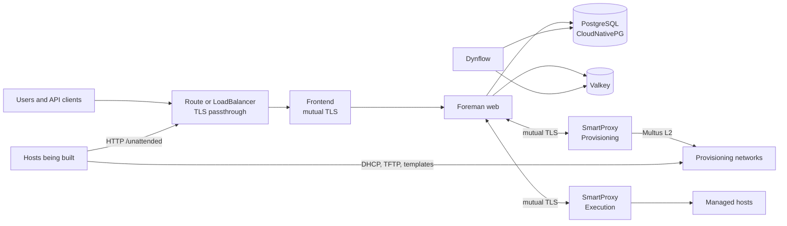

# 👷 foreman-operator

[](https://github.com/slauger/foreman-operator/actions/workflows/ci.yaml)
[](LICENSE)
[](#project-status)

A Kubernetes Operator that maps [Foreman](https://theforeman.org/) and Smart Proxy infrastructure onto native building blocks - CRDs, Secrets, cert-manager, CloudNativePG, and Multus - for running Foreman and bare-metal provisioning on **Kubernetes** and **OpenShift**.

> **Experimental.** This is an unofficial, unsupported prototype. It is not affiliated with or endorsed by the Foreman project. No controllers exist yet, and the API will change without notice. Do not use it in production.

## Project status

| Area | State |
|---|---|
| Concept and documentation | Draft |
| CRD types and generated CRDs | Implemented, not tested against an API server |
| CloudNativePG chart | Implemented, not tested on a cluster |
| Controllers | Not started |
| Container images | Not started |

The planned order is described in the [roadmap](docs/roadmap.md).

Some concepts and ideas were adopted from [theforeman/foreman-kubernetes](https://github.com/theforeman/foreman-kubernetes), the community effort to run Foreman on Kubernetes. See [Acknowledgements](docs/acknowledgements.md).

## Planned features

<!-- features: keep in sync with docs/_snippets/features.md -->
- 🌐 **Foreman on Kubernetes** - Web, Dynflow, and recurring tasks as native workloads, declared through CRDs
- 🛰️ **Smart Proxy as a Resource** - Each proxy is one `SmartProxy` with a profile, registered in Foreman automatically
- 🥾 **Bare-Metal Provisioning** - PXE, DHCP, TFTP, and DNS on direct L2 networks through Multus
- 🔐 **cert-manager Integration** - Public certificates for clients, an internal PKI for mutual TLS
- 🐘 **CloudNativePG** - PostgreSQL through CloudNativePG, with a chart for the cluster
- 🔒 **Rootless and OpenShift Ready** - Own UBI 9 images, built for random UIDs
- 🚪 **TLS Passthrough Frontend** - Client certificates work the same on k3s and OpenShift
- 🔌 **Plugin Catalog** - Plugins, proxy plugins, and dependencies resolved by the operator
- 🛡️ **Supply Chain Security** - Cosign signed images, SLSA provenance, SBOM, Conforma policy validation, and Renovate
- 🧭 **Katello Later** - Candlepin and Pulp are a separate, later stage
<!-- /features -->

## Architecture



A **Foreman** is the root resource. It owns the web workload, the Dynflow workloads, recurring tasks, and database migrations. A **Frontend** terminates mutual TLS inside the cluster and exposes Foreman through a passthrough Route or LoadBalancer. A **SmartProxy** is one proxy registered in Foreman, with a profile that selects its features and privileges. A provisioning proxy runs DHCP and TFTP next to the proxy process and attaches to a provisioning network through Multus.

## CRD Model

All resources use the API group `platform.theforeman.org/v1alpha1`.

| Kind | State | Purpose | Creates (planned) |
|---|---|---|---|
| **`Foreman`** | API defined | FQDN, image, plugins, database and Valkey references | Deployments, CronJobs, migration Job, ConfigMaps, Certificates |
| **`Frontend`** | API defined | Mutual TLS, path routing, exposure | Deployment, Service, Route or TLSRoute, Certificates |
| **`SmartProxy`** | API defined | One registered proxy with a profile, networks, and features | Pod with sidecars, Service, PVC, Certificates |
| **`Release`** | Planned | Compatible image sets, ordered upgrades | Jobs, status |
| **`Candlepin`** | Planned | Subscription service for Katello | Deployment, Service, Secrets |
| **`Pulp`** | Planned | Content service for Katello | Deployments, Job, registration |

Certificates come from cert-manager. PostgreSQL comes from CloudNativePG. Foreman objects such as subnets, domains, and hosts stay in Foreman.

## Differences to VM-based Installations

| | foreman-installer or foremanctl | foreman-operator (planned) |
|---|---|---|
| **Configuration** | Answer files or Ansible parameters | Declarative CRDs |
| **Orchestration** | systemd, Puppet or Ansible | Kubernetes controllers |
| **Privileges** | Root on the host | Rootless, random UID compatible |
| **Certificates** | Generated on the host | cert-manager |
| **Database** | Local or external PostgreSQL | CloudNativePG |
| **TLS frontend** | Apache from a host package | `Frontend` resource with its own image |
| **Smart Proxy network** | Host network | Pod network, Multus for provisioning |
| **DHCP and TFTP** | Host services | Sidecars in the proxy pod |
| **Scaling** | Single host | Web and workers scale independently |

## Quick Start

There is no operator to install yet. You can inspect the API and create the database:

```bash
kubectl apply -f config/crd/bases/

# Requires the CloudNativePG operator
helm install foreman-db charts/foreman-db-cnpg \
  --namespace foreman \
  --create-namespace
```

Example resources are in [`config/samples`](config/samples). Applying them has no effect until the controllers exist.

## Local Development

```bash
make test          # Generate, format, vet, and run unit tests
make ci            # All CI checks
make docs-serve    # Documentation with live reload
```

See [Contributing](CONTRIBUTING.md).

## Supply Chain Security

Dependencies are kept current by Renovate, and CI runs `govulncheck` and `golangci-lint`. Published images are planned to be signed with cosign and to carry SLSA provenance and SBOMs, validated with Conforma. The reusable workflows are in place, but no images are built yet. See [Supply Chain Security](docs/guides/supply-chain-security.md).

## Documentation

The documentation sources are in [`docs/`](docs/index.md). Build them with `make docs-build`.

## License

Apache License 2.0. Foreman and Smart Proxy are separate projects licensed under GPL-3.0.
