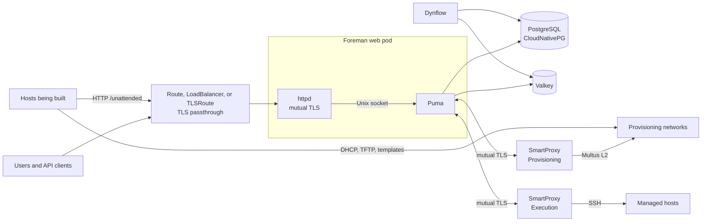

# 👷 foreman-operator

[](https://github.com/slauger/foreman-operator/actions/workflows/ci.yaml)
[](https://github.com/slauger/foreman-operator/releases)
[](LICENSE)
[](#status)

A Kubernetes Operator that maps [Foreman](https://theforeman.org/) and Smart Proxy infrastructure onto native building blocks - CRDs, Secrets, cert-manager, CloudNativePG, and Multus - for running Foreman and bare-metal provisioning on **Kubernetes** and **OpenShift**.

> **Experimental.** This is an unofficial, unsupported prototype. It is not affiliated with or endorsed by the Foreman project. The API will change without notice. Do not use it in production.

## Status

Foreman with its frontend, Smart Proxies for provisioning and for Remote Execution, checked upgrades, and the restore order are implemented and pass the E2E tests on a k3s cluster. Releases publish signed images and charts. A real PXE build on a real network, OpenShift, and Katello are not done yet. See the [roadmap](docs/roadmap.md).

Some concepts and ideas were adopted from [theforeman/foreman-kubernetes](https://github.com/theforeman/foreman-kubernetes), the community effort to run Foreman on Kubernetes. See [Acknowledgements](docs/acknowledgements.md).

## Features

<!-- features: keep in sync with docs/_snippets/features.md -->
- 🌐 **Foreman on Kubernetes** - Web and Dynflow as native workloads, declared through a `Foreman` resource
- 🧱 **Checked Upgrades** - A preflight refuses skipped releases and waits for running tasks, writers stop while a Job migrates the database, and smoke checks verify the new version; no rollback onto a partly migrated database
- 💾 **Backup and Restore** - A documented restore order for the database and secrets, exercised by a restore drill
- 🛰️ **Smart Proxy as a Resource** - Each proxy is one `SmartProxy`, registered in Foreman automatically through OAuth, for provisioning or for Remote Execution and Ansible over SSH
- 🥾 **Bare-Metal Provisioning** - DHCP and TFTP through dnsmasq, DNS through nsupdate, BMC, and Discovery, on direct L2 networks through Multus
- 🔐 **cert-manager Integration** - Server, client, and proxy certificates requested from cert-manager issuers
- 🐘 **CloudNativePG** - PostgreSQL through CloudNativePG, with a chart for the cluster
- 🚪 **TLS Passthrough Frontend** - Apache with mutual TLS as a sidecar of Puma, behind a LoadBalancer, an OpenShift Route, or a Gateway API TLSRoute; Puma listens only on a Unix socket
- 🧩 **Plugin Catalog** - Remote Execution, Ansible, Boot Disk, Discovery, Templates, Webhooks, Puppet, and the KubeVirt and Proxmox compute resources in the Foreman image, enabled per instance; VMware is always available
- ⏰ **Recurring Tasks** - The Foreman cron tasks as CronJobs, suspended during migrations
- 🔒 **Rootless Images** - Own UBI 9 images, built for random UIDs; only dnsmasq starts as root, with a minimal capability set
- 🛡️ **Supply Chain Security** - Pinned Foreman RPMs tracked by Renovate, cosign-signed release images and charts, provenance, and SBOMs
- 🧭 **Planned** - OpenShift qualification, a real PXE build, `Release` image sets, and Katello
<!-- /features -->

## Architecture



A **`Foreman`** is the root resource. It owns the web and Dynflow workloads, the recurring task CronJobs, and the database migrations. Every web pod runs Apache next to Puma; Apache terminates mutual TLS and reaches Puma only over a Unix socket. A **`SmartProxy`** is one proxy registered in Foreman: `Provisioning` runs dnsmasq for DHCP and TFTP on a Multus network, `Execution` runs Remote Execution and Ansible over SSH. Certificates come from cert-manager and PostgreSQL from CloudNativePG. Subnets, domains, and hosts stay in Foreman. See [Architecture](docs/concepts/architecture.md).

## Differences to VM-based Installations

| | foreman-installer or foremanctl | foreman-operator |
|---|---|---|
| **Configuration** | Answer files or Ansible parameters | Declarative CRDs |
| **Orchestration** | systemd, Puppet or Ansible | Kubernetes controllers |
| **Upgrades** | Installer run, one release at a time | Image change; preflight, fenced migration Job, smoke checks |
| **Privileges** | Root on the host | Rootless, random UID compatible; dnsmasq with a minimal capability set |
| **Certificates** | Generated on the host | cert-manager |
| **Database** | Local or external PostgreSQL | CloudNativePG |
| **TLS frontend** | Apache from a host package | Apache container in every web pod, own image |
| **Smart Proxy network** | Host network | Pod network, Multus for provisioning |
| **DHCP and TFTP** | Host services | dnsmasq container in the proxy pod |
| **Scaling** | Single host | Web and workers scale independently; the frontend scales with web |

## Quick Start

cert-manager, CloudNativePG, and a Valkey instance must already exist in the cluster.

```bash
VERSION=0.1.0

# Helm does not upgrade CRDs, so they are applied explicitly
helm pull oci://ghcr.io/slauger/charts/foreman-operator --version "${VERSION}" --untar
kubectl apply --server-side -f foreman-operator/crds/

helm install foreman-operator oci://ghcr.io/slauger/charts/foreman-operator \
  --version "${VERSION}" --namespace foreman-operator --create-namespace

helm install foreman-db oci://ghcr.io/slauger/charts/foreman-db-cnpg \
  --version "${VERSION}" --namespace foreman --create-namespace
```

Then create a `Foreman`. The [Getting Started](docs/guides/getting-started.md) guide walks through the internal CA, Valkey, the example resources, and the first login. Example resources are also in [`config/samples`](config/samples).

## Documentation

| | |
|---|---|
| [Getting Started](docs/guides/getting-started.md) | Install the operator, create Foreman and a provisioning proxy |
| [Remote Execution](docs/guides/remote-execution.md) | Plugins and an `Execution` proxy |
| [Upgrades](docs/concepts/upgrades.md) | Preflight, migration, smoke checks, and recovery |
| [Backup and Restore](docs/guides/backup-restore.md) | What to back up and the restore order |
| [API Reference](docs/reference/index.md) | All fields of `Foreman` and `SmartProxy` |
| [Testing](docs/development/testing.md) | Unit, envtest, chart, E2E, upgrade, and restore tests |
| [Roadmap](docs/roadmap.md) | What is done and what comes next |

Build the documentation locally with `make docs-serve`.

## Development

```bash
make test          # Generate, format, vet, and run unit and envtest tests
make ci            # All CI checks
make run           # Run the operator against the current kubeconfig
```

See [Contributing](CONTRIBUTING.md) and [Local Setup](docs/development/local-setup.md).

## License

Apache License 2.0. Foreman and Smart Proxy are separate projects licensed under GPL-3.0.
