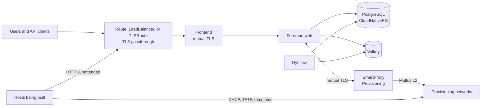

# 👷 foreman-operator

[](https://github.com/slauger/foreman-operator/actions/workflows/ci.yaml)
[](LICENSE)
[](#project-status)

A Kubernetes Operator that maps [Foreman](https://theforeman.org/) and Smart Proxy infrastructure onto native building blocks - CRDs, Secrets, cert-manager, CloudNativePG, and Multus - for running Foreman and bare-metal provisioning on **Kubernetes** and **OpenShift**.

> **Experimental.** This is an unofficial, unsupported prototype. It is not affiliated with or endorsed by the Foreman project. The API will change without notice. Do not use it in production.

## Project status

| Area | State |
|---|---|
| CRD types and generated CRDs | Implemented, validation tested with envtest |
| `Foreman` controller | Implemented, migration, web, and Dynflow verified on a k3s cluster |
| `Frontend` controller | Implemented, verified on a k3s cluster through a Gateway API TLSRoute |
| `SmartProxy` controller | Implemented, E2E test passes on k3s with a fake VLAN |
| Container images | Built by CI, public on GHCR, unsigned while the repository is private |
| Helm chart for the operator | Implemented, not published to a registry yet |
| CloudNativePG chart | Implemented, used by the E2E setup |
| OpenShift | Not qualified |

The MVP covers v0.1 and v0.2 of the [roadmap](docs/roadmap.md).

Some concepts and ideas were adopted from [theforeman/foreman-kubernetes](https://github.com/theforeman/foreman-kubernetes), the community effort to run Foreman on Kubernetes. See [Acknowledgements](docs/acknowledgements.md).

## Features

<!-- features: keep in sync with docs/_snippets/features.md -->
- 🌐 **Foreman on Kubernetes** - Web and Dynflow as native workloads, declared through a `Foreman` resource
- 🧱 **Migration before Rollout** - Writers are stopped, a Job migrates the database, then the new version rolls out
- 🛰️ **Smart Proxy as a Resource** - Each proxy is one `SmartProxy`, registered in Foreman automatically through OAuth
- 🥾 **Bare-Metal Provisioning** - DHCP and TFTP through dnsmasq, DNS through nsupdate, on direct L2 networks through Multus
- 🔐 **cert-manager Integration** - Server, client, and proxy certificates requested from cert-manager issuers
- 🐘 **CloudNativePG** - PostgreSQL through CloudNativePG, with a chart for the cluster
- 🚪 **TLS Passthrough Frontend** - Apache with mutual TLS behind a LoadBalancer, an OpenShift Route, or a Gateway API TLSRoute
- 🔒 **Rootless Images** - Own UBI 9 images, built for random UIDs; only dnsmasq starts as root, with a minimal capability set
- 🛡️ **Supply Chain Security** - BuildKit provenance and SBOMs, Renovate, and govulncheck; cosign signing once the repository is public
- 🧭 **Planned** - Plugin catalog, Remote Execution, recurring tasks, `Release` upgrades, OpenShift qualification, and Katello
<!-- /features -->

## Architecture



A **Foreman** is the root resource. It owns the web workload, the Dynflow workloads, and database migrations. A **Frontend** terminates mutual TLS inside the cluster and exposes Foreman through a passthrough Route, a LoadBalancer, or a Gateway API TLSRoute. A **SmartProxy** is one proxy registered in Foreman. A provisioning proxy runs dnsmasq for DHCP and TFTP next to the proxy process and attaches to a provisioning network through Multus.

## CRD Model

All resources use the API group `platform.theforeman.org/v1alpha1`.

| Kind | State | Purpose | Creates |
|---|---|---|---|
| **`Foreman`** | Implemented | FQDN, image, database and Valkey references | Deployments, migration Job, Service, Secrets, ConfigMap, Certificate |
| **`Frontend`** | Implemented | Mutual TLS, exposure | Deployment, Service, ConfigMap, Route or TLSRoute and HTTPRoute, Certificates |
| **`SmartProxy`** | Implemented for `Provisioning` | One registered proxy with networks and features | Deployment with a dnsmasq container, Service, ConfigMap, PVC, Certificate, Foreman registration |
| **`Release`** | Planned | Compatible image sets, ordered upgrades | Jobs, status |
| **`Candlepin`** | Planned | Subscription service for Katello | Deployment, Service, Secrets |
| **`Pulp`** | Planned | Content service for Katello | Deployments, Job, registration |

Certificates come from cert-manager. PostgreSQL comes from CloudNativePG. Foreman objects such as subnets, domains, and hosts stay in Foreman.

## Differences to VM-based Installations

| | foreman-installer or foremanctl | foreman-operator |
|---|---|---|
| **Configuration** | Answer files or Ansible parameters | Declarative CRDs |
| **Orchestration** | systemd, Puppet or Ansible | Kubernetes controllers |
| **Privileges** | Root on the host | Rootless, random UID compatible; dnsmasq with a minimal capability set |
| **Certificates** | Generated on the host | cert-manager |
| **Database** | Local or external PostgreSQL | CloudNativePG |
| **TLS frontend** | Apache from a host package | `Frontend` resource with its own image |
| **Smart Proxy network** | Host network | Pod network, Multus for provisioning |
| **DHCP and TFTP** | Host services | dnsmasq container in the proxy pod |
| **Scaling** | Single host | Web and workers scale independently |

## Quick Start

The chart is not published yet. Install it from a checkout. cert-manager, CloudNativePG, and a Valkey instance must already exist in the cluster.

```bash
# Helm does not upgrade CRDs, so they are applied explicitly
kubectl apply --server-side -f charts/foreman-operator/crds/

# No release image exists yet, so the image tag is set explicitly
helm install foreman-operator charts/foreman-operator \
  --namespace foreman-operator \
  --create-namespace \
  --set image.tag=develop

helm install foreman-db charts/foreman-db-cnpg \
  --namespace foreman \
  --create-namespace
```

Then create a `Foreman` and a `Frontend`. The [Getting Started](docs/guides/getting-started.md) guide walks through the prerequisites, example resources, and the first login. Example resources are also in [`config/samples`](config/samples).

## Local Development

```bash
make test          # Generate, format, vet, and run unit and envtest tests
make cover         # Tests with the coverage gate
make ci            # All CI checks
make run           # Run the operator against the current kubeconfig
make docs-serve    # Documentation with live reload
```

See [Contributing](CONTRIBUTING.md).

## Testing

| Level | What | Command |
|---|---|---|
| Unit | Builders, configuration rendering, OAuth signing | `make test` |
| Controller | Reconcilers against a fake client | `make test` |
| API | CEL validation rules against an envtest API server | `make test` |
| Chart | helm-unittest | `make helm-unittest` |
| End to end | Chainsaw test `tests/e2e/mvp` on a k3s cluster with Multus, cert-manager, CloudNativePG, and Envoy Gateway | `tests/e2e/setup.sh`, then `chainsaw test` |

CI enforces a total coverage of at least 60 percent. The Chainsaw E2E test passes on a k3s cluster with cert-manager, CloudNativePG, Multus, and Envoy Gateway, both against an existing installation and from scratch.

## Supply Chain Security

Dependencies are kept current by Renovate, and CI runs `govulncheck` and `golangci-lint`. Images are built with BuildKit provenance and SBOMs. They are not signed while the repository is private, because keyless signatures would publish repository details to the public Sigstore log. See [Supply Chain Security](docs/guides/supply-chain-security.md).

## Documentation

The documentation sources are in [`docs/`](docs/index.md). Build them with `make docs-build`.

## License

Apache License 2.0. Foreman and Smart Proxy are separate projects licensed under GPL-3.0.
