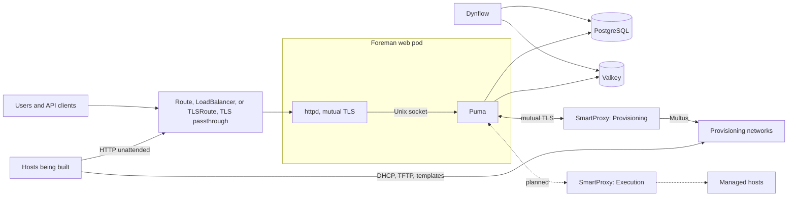
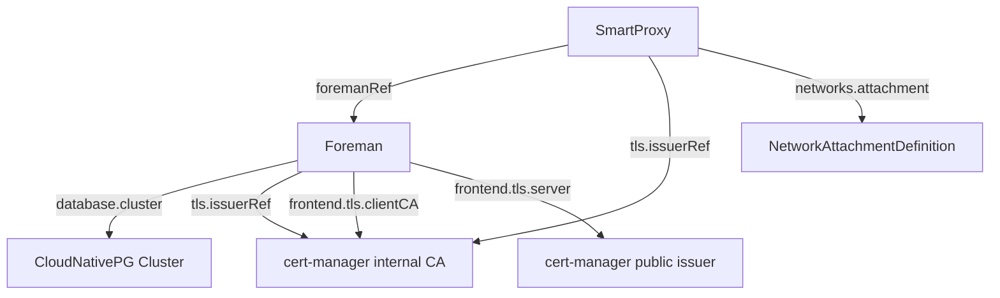

# Architecture

!!! note "Status"
    The `Foreman` and `SmartProxy` controllers are implemented as an MVP. The frontend is part of `Foreman` and runs in the web pods. The `Execution` profile, recurring tasks, `Release`, and the Katello kinds are target design. Rows and sections below say which parts are planned.

## Overview

The operator follows the standard Kubernetes operator pattern. Controllers watch custom resources and create native workloads directly, with owner references, without rendering through Helm.

## Operator startup

At startup, the operator checks which optional APIs the cluster serves and only watches kinds that exist:

| Capability | Detected through | Used for |
|---|---|---|
| cert-manager | `cert-manager.io/v1` `Certificate` | Every `tls.issuerRef` |
| Gateway API | `gateway.networking.k8s.io/v1` `TLSRoute` and `HTTPRoute` | Exposure `TLSRoute` |
| OpenShift | `route.openshift.io/v1` `Route` | Exposure `Route` and `Auto`, no `fsGroup` in pod security contexts |

A resource that needs a missing capability fails with a reconcile error. APIs installed after the operator started are only seen after a restart.

| Flag | Default | Description |
|---|---|---|
| `--default-image-tag` | `develop` | Tag of the component images when a resource names neither tag nor digest |
| `--watch-namespace` | empty | Restricts the operator to one namespace. Empty watches all namespaces |
| `--leader-elect` | `false` | Enables leader election |
| `--metrics-secure` | `false` | Serves metrics over HTTPS with authentication and authorization |

## CRD Relationships

## Workloads

| Component | Workload | Replicas | Process | State |
|---|---|---|---|---|
| Foreman web | Deployment | 2 by default | Container `foreman`: Rails with Puma on a Unix socket. Container `httpd`: Apache with `mod_ssl` on ports 8443 and 8080 | Implemented |
| Dynflow orchestrator | Deployment, Recreate | 1 | Sidekiq with the orchestrator configuration | Implemented |
| Dynflow worker | Deployment | 1 by default | Sidekiq with the worker configuration | Implemented |
| Dynflow hosts queue | Deployment | 0 by default | Sidekiq with the hosts queue configuration | Implemented |
| Foreman migration | Job | n/a | `db:migrate`, `db:seed`, and `upgrade:run` | Implemented |
| Smart Proxy | Deployment, Recreate | 1 | See [Smart Proxy](smart-proxy.md) | Implemented for `Provisioning` |
| Recurring tasks | CronJob | n/a | `foreman-rake cron:hourly`, daily, weekly, monthly | Planned |

The process split follows the `foremanctl` deployment. Apache runs as a sidecar of Puma rather than as a separate Deployment, so Puma has no TCP listener and no other pod can forge the client certificate headers. Mutual TLS between a separate frontend and Puma would need extra certificates and still leave a port open. The trade-off is that frontend and web scale 1:1 and a frontend change restarts the web pods. See [Traffic Flow](traffic-flow.md#why-a-sidecar). Puma workers are derived from the memory limit of the web container, about 1.5 GiB per worker, between 1 and 16.

Foreman core uses Dynflow as its ActiveJob backend, independent of Katello, for example for report templates, notifications, and event subscribers. The orchestrator and one worker are therefore part of every deployment. The hosts queue is only needed for Remote Execution, so it defaults to zero replicas.

## Deliberately not CRDs

- **Certificates** are cert-manager resources.
- **Plugins** are a list on `Foreman`.
- **DHCP, TFTP, and DNS** are features of a `SmartProxy`, because they share a pod and its state.
- **Subnets, domains, and hosts** stay in Foreman. A second source of truth would conflict with Foreman's own data.

## Patterns

- One builder per child object.
- Configuration through mounted files, generated by the operator, not entrypoint scripts.
- A checksum of the rendered configuration in the pod template annotation `platform.theforeman.org/config-checksum` triggers rollouts. It includes the data of the certificate Secrets, and healthy resources are reconciled every 10 minutes, so a certificate renewed by cert-manager rolls the pods out within that interval.
- The annotation `platform.theforeman.org/paused: "true"` suspends reconciliation of one object.
- Objects that must survive the custom resource, such as `<name>-secrets` of a Foreman and the PVC of a Smart Proxy, have no owner reference.
- All pods disable service links.
- Read-only root filesystems with explicit `emptyDir` mounts, where the applications allow it. Planned, not set yet.
