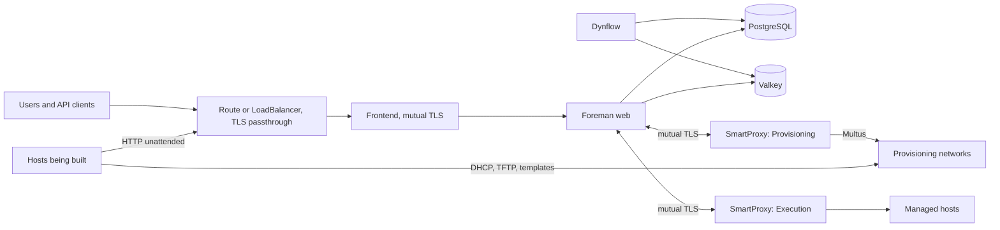
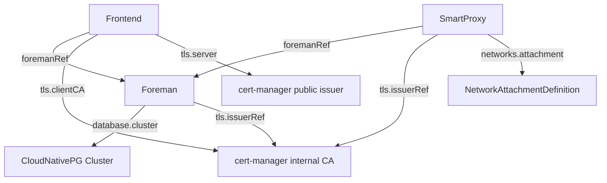

# Architecture

!!! note "Status"
    This page describes the target design. The CRD types exist. The controllers do not.

## Overview

The operator follows the standard Kubernetes operator pattern. Controllers watch custom resources and create native workloads directly, with owner references, without rendering through Helm.

## CRD Relationships

## Workloads

| Component | Workload | Replicas | Process |
|---|---|---|---|
| Frontend | Deployment | 2+ | Apache `httpd` with `mod_ssl` |
| Foreman web | Deployment | 2+ | Rails server on port 3000 |
| Dynflow orchestrator | Deployment, Recreate | 1 | Sidekiq with the orchestrator configuration |
| Dynflow worker | Deployment | 1+ | Sidekiq with the worker configuration |
| Dynflow hosts queue | Deployment | 0+ | Sidekiq with the hosts queue configuration |
| Recurring tasks | CronJob | n/a | `foreman-rake cron:hourly`, daily, weekly, monthly |
| Foreman migration | Job | n/a | `db:migrate`, `db:seed`, and `upgrade:run` |
| Smart Proxy | Deployment, Recreate | 1 | See [Smart Proxy](smart-proxy.md) |

The process split follows the `foremanctl` deployment. Puma workers are derived from the container limits.

Foreman core uses Dynflow as its ActiveJob backend, independent of Katello, for example for report templates, notifications, and event subscribers. The orchestrator and one worker are therefore part of every deployment. The hosts queue is only needed for Remote Execution, so it defaults to zero replicas.

## Deliberately not CRDs

- **Certificates** are cert-manager resources.
- **Plugins** are a list on `Foreman`.
- **DHCP, TFTP, and DNS** are features of a `SmartProxy`, because they share a pod and its state.
- **Subnets, domains, and hosts** stay in Foreman. A second source of truth would conflict with Foreman's own data.

## Patterns

- One builder per child object.
- Configuration through mounted files, not entrypoint scripts.
- A hash of rendered configuration and certificates in the pod template triggers rollouts.
- The annotation `platform.theforeman.org/paused` suspends reconciliation of one object.
- Read-only root filesystems with explicit `emptyDir` mounts, where the applications allow it.
