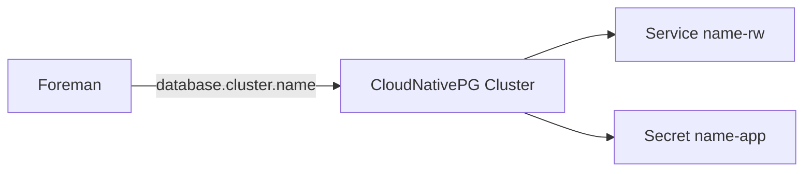

# Database

!!! note "Status"
    The chart exists and renders. It has not been tested on a cluster. The `Foreman` controller does not exist yet.

PostgreSQL is provided by [CloudNativePG](https://cloudnative-pg.io/). A `Foreman` references a `Cluster` in its namespace.



## Create a cluster

```bash
helm install foreman-db charts/foreman-db-cnpg --namespace foreman --create-namespace
```

```yaml
spec:
  database:
    cluster:
      name: foreman-db
```

The operator connects to the `<name>-rw` Service and reads credentials from the `<name>-app` Secret. `credentialsSecretRef` overrides the Secret name.

## Decisions

- **PostgreSQL 16**, the major version used by `foremanctl`.
- **CloudNativePG only.** A second path for external servers can be added later if needed.
- **One cluster per application database.** Katello adds separate clusters for Candlepin and Pulp, which keeps backups and upgrades independent.

Required PostgreSQL extensions have not been audited yet. `postInitSQL` can add them.

## Backup

Use CloudNativePG continuous backups and `ScheduledBackup`. A restore also needs the secrets listed in [Upgrades](upgrades.md#backup-and-restore).

## Valkey

Foreman also needs Valkey for the Rails cache and for Dynflow, which makes it a required dependency. The operator consumes an existing instance through `spec.valkey`. `foremanctl` uses database 4 for the cache and 6 for Dynflow.
