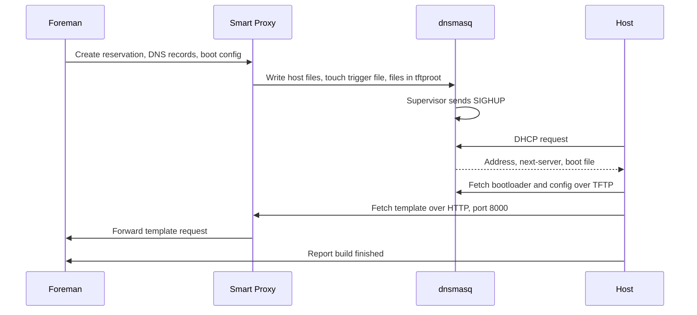

# Provisioning

!!! note "Status"
    Implemented as MVP for the `Provisioning` profile with dnsmasq. The pod layout and the dnsmasq privileges were verified in the [PXE lab](../development/testing.md#pxe-lab) with manual manifests. The operator-built pod, registration, DHCP, TFTP, and DNS are covered by the E2E test but have not been run on a cluster yet. No real host has been built.

## Flow

The smart-proxy documentation notes that most installers do not support HTTPS, so port 8000 serves plain HTTP on the provisioning network.

## Pod layout

| Container | Role | Security context | Shared state |
|---|---|---|---|
| `boot-files` (init) | Copies boot loaders into the TFTP root | Restricted | Writes the TFTP root |
| `proxy` | Smart Proxy API and modules | Restricted, non-root, all capabilities dropped | Writes host files, the trigger file, and the TFTP root |
| `dnsmasq` | DHCP and TFTP | Root, all capabilities dropped except `NET_ADMIN`, `NET_RAW`, `NET_BIND_SERVICE`, `SETUID`, `SETGID`, and `KILL` | Reads host files and the TFTP root, writes leases |

The `boot-files` init container runs only with the `tftp` feature. The `dnsmasq` container runs with the `dnsmasq` DHCP provider or with `tftp`. Both require a network.

The capability set of the `dnsmasq` container is the minimal set found in the lab. The supervisor needs `NET_ADMIN` to assign the static address, `SETUID` and `SETGID` let dnsmasq drop to user `dnsmasq`, and `KILL` lets the supervisor signal dnsmasq after that. dnsmasq itself starts with a bounding set without `KILL` and keeps only `NET_ADMIN` and `NET_RAW` effective after dropping privileges. Because the container runs as root with added capabilities, the namespace needs the Pod Security level `privileged`.

| Volume | Mounted at | Content |
|---|---|---|
| `<name>-data` PVC, subdirectory `tftpboot` | `/var/lib/tftpboot` | TFTP root with boot loaders and host boot files |
| `<name>-data` PVC, subdirectory `dhcp` | `/var/lib/foreman-proxy/dhcp` | `dhcphosts`, `dhcpopts.conf`, the lease file, and the reload trigger |

Without `storage`, the same subdirectories live on an `emptyDir`, and reservations and leases are lost when the pod is recreated. The DHCP directory is kept outside the TFTP root, so reservations and leases are not served over TFTP.

## DHCP provider

The default is `dnsmasq` through the [`smart_proxy_dhcp_dnsmasq`](https://github.com/theforeman/smart_proxy_dhcp_dnsmasq) plugin:

- `dnsmasq` is part of UBI 9, and it serves both DHCP and TFTP.
- The plugin writes `dhcp-hostsfile` and `dhcp-optsfile` data and calls a reload command.
- **The plugin supports only one subnet.** Each L2 network therefore needs its own `SmartProxy`. The CRD enforces this.
- The plugin reads the subnet from a `dhcp-range` with four fields (`first,last,netmask,lease time`) and understands only numeric `dhcp-option` codes. The operator renders the configuration accordingly, with option 3 for `gateway` and option 6 for `dnsServers`.
- The operator writes no global `dhcp-boot`. The boot file and next server come from the reservation Foreman creates for each host.
- The reload command only creates a trigger file. A supervisor in the dnsmasq container turns it into a SIGHUP, so the pod needs no shared process namespace.

ISC DHCP and `tftp-server` are not available in UBI 9. No Kea provider was found. `infoblox`, an alternative for an existing DHCP service, is rejected by the API until its plugin is in the image.

## Multus rules

Provisioning networks use direct L2, without DHCP relays. Multus gives the pod presence on that network. The operator sets the annotation `k8s.v1.cni.cncf.io/networks` with the interface `net1`. A `SmartProxy` has at most one network, so each L2 network needs its own `SmartProxy`, which the one-subnet limit of the DHCP plugin requires anyway.

- The Deployment uses `Recreate`. Two pods must never hold the same static IP during a rollout.
- The supervisor assigns the address to `net1`, so the NetworkAttachmentDefinition can use `"ipam": {}`. dnsmasq binds to `net1` only.
- Trunk the VLAN to every node that may run the pod, and restrict the pod with a node selector. The operator does not expose a node selector yet.
- Virtual nodes usually need the hypervisor to permit macvlan traffic.
- Standard NetworkPolicy does not apply to secondary interfaces. Treat the attached network as a separate trust zone and add MultiNetworkPolicy where the CNI supports it.
- Add routes for the provisioning subnet through the secondary interface and check `rp_filter`.
- On OpenShift, the dnsmasq container needs a dedicated SCC, which is not written yet.
- An RWO volume can stay attached after node failure until the node is fenced. Recovery is not automatic in every case.

## DNS and BMC

DNS uses an external server through `dns_nsupdate` with a TSIG key from `dns.keySecretRef`. `nsupdate` comes from `bind-utils` in the Smart Proxy image. `dns_nsupdate_gss` is rejected by the API until a keytab can be mounted.

BMC supports the `ipmitool`, `redfish`, `shell`, and `ssh` providers. `ipmitool` is not in UBI 9 and comes from CentOS Stream 9, see [Container Images](images.md#smart-proxy-image). `freeipmi` is not available. The BMC network must be reachable from the proxy pod, either over the pod network or a Multus attachment.

## Discovery

`foreman_discovery` resolves against the planned package sources but is not in the image. `smart_proxy_discovery` has the same open dependencies as `foreman-proxy`, see [Container Images](images.md). Discovery is a candidate for a later version, see [Plugins](plugins.md).
