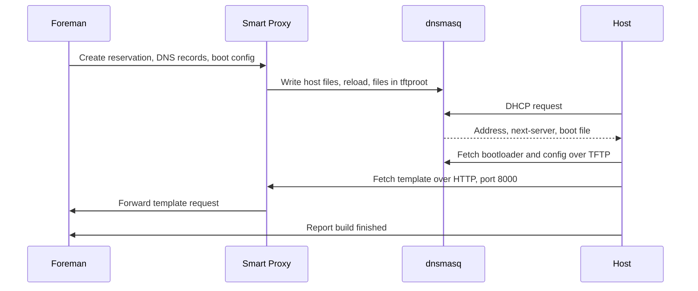

# Provisioning

!!! note "Status"
    Target design, not tested. This is the largest open risk of the project and the subject of the first spike.

## Flow

The smart-proxy documentation notes that most installers do not support HTTPS, so port 8000 serves plain HTTP on the provisioning network.

## Pod layout

| Container | Role | Shared state |
|---|---|---|
| `boot-files` (init) | Copies bootloaders into `tftproot` | Writes `tftproot` |
| `smart-proxy` | API and modules | Writes host files and `tftproot` |
| `dnsmasq` | DHCP and TFTP | Reads host files, leases on PVC, reads `tftproot` |

## DHCP provider

The default is `dnsmasq` through the [`smart_proxy_dhcp_dnsmasq`](https://github.com/theforeman/smart_proxy_dhcp_dnsmasq) plugin:

- `dnsmasq` is part of UBI 9, and it serves both DHCP and TFTP.
- The plugin writes `dhcp-hostsfile` and `dhcp-optsfile` data and calls a reload command.
- **The plugin supports only one subnet.** Each L2 network therefore needs its own `SmartProxy`. The CRD enforces this.
- The reload command must reach the dnsmasq process in the sidecar. Sharing the process namespace of the pod is the likely solution.
- The plugin was last changed in October 2025. Its fitness must be verified in the spike.

ISC DHCP and `tftp-server` are not available in UBI 9. No Kea provider was found. `infoblox` is the alternative for an existing DHCP service.

## Multus rules

Provisioning networks use direct L2, without DHCP relays. Multus gives the pod presence on those networks.

- Use `Recreate`. Two pods must never hold the same static IP during a rollout.
- Use static IPAM for stable service and `next-server` addresses.
- Trunk the VLAN to every node that may run the pod, and restrict the pod with a node selector.
- Virtual nodes usually need the hypervisor to permit macvlan traffic.
- Standard NetworkPolicy does not apply to secondary interfaces. Treat the attached network as a separate trust zone and add MultiNetworkPolicy where the CNI supports it.
- Add routes for the provisioning subnet through the secondary interface and check `rp_filter`.
- dnsmasq typically needs `NET_ADMIN`, `NET_RAW`, and `NET_BIND_SERVICE`. These do not fit Pod Security `restricted`, so this profile runs in its own namespace, with a dedicated SCC on OpenShift.
- An RWO volume can stay attached after node failure until the node is fenced. Recovery is not automatic in every case.

## DNS and BMC

DNS uses an external server through `dns_nsupdate` or `dns_nsupdate_gss`.

BMC is open. Neither `ipmitool` nor `freeipmi` is available in UBI 9. The spike decides between Redfish and an additional package source.

## Discovery

`foreman_discovery` resolves against the planned package sources. `smart_proxy_discovery` has the same open dependencies as `foreman-proxy`, see [Container Images](images.md). Discovery is a candidate for v0.2, see [Plugins](plugins.md).
