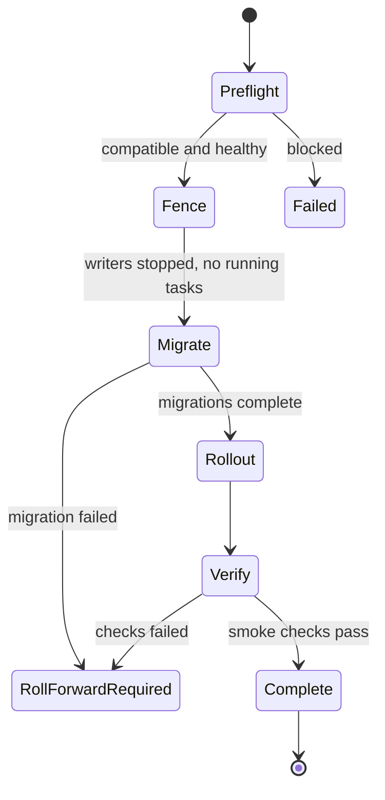

# Upgrades

!!! note "Status"
    Fence and Migrate are implemented in the `Foreman` controller and verified on the E2E cluster for the initial migration. Preflight, Verify, the `Release` CRD, and roll forward handling are target design.

Until `Release` exists, an upgrade is a new image in `Foreman.spec.image`, with the migration Job running before the rollout. This is intended for testing only.

## Implemented today

The `Foreman` controller computes a migration hash over the image reference and the sorted plugin list. When it differs from `status.appliedMigrationHash`:

1. All web and Dynflow Deployments are scaled to zero.
2. The controller waits until no Foreman pods remain, except migration pods.
3. Older migration Jobs are deleted, and the Job `<name>-migrate-<hash>` runs `db:migrate`, `db:seed`, and `upgrade:run`.
4. After the Job completes, the hash is recorded and the Deployments roll out with the new image.

A failed Job sets the phase to `Failed` and the condition `Degraded` with reason `MigrationFailed`. Delete the Job to retry. The Job has a backoff limit of 3. There is no automatic rollback.

## Target design

- **Preflight** checks image compatibility, single-step upgrade, certificate validity, and running tasks. Foreman must be upgraded one release at a time.
- **Fence** stops every writer to a schema being migrated.
- **Migrate** runs one Job per schema owner. For Foreman, the Job runs `db:migrate`, `db:seed`, and `upgrade:run`, in this order. `upgrade:run` executes one-time data tasks of a release and refuses to run while migrations or seeds are pending.
- Automatic rollback is not offered after a migration has run.
- Smart Proxies are upgraded after Foreman. DHCP and TFTP keep serving during a Foreman upgrade, but Foreman cannot change reservations while it is fenced.

## Health

Web readiness and startup probes use the HTTP status of `/api/v2/ping` only, with the `Host` header set to `spec.fqdn`. Liveness is a TCP check. The response body includes dependency status, which must not remove all web pods when a dependency fails.

## Backup and restore

Losing any of these makes a restore partly or fully unusable:

- the Secret `<name>-secrets`, which holds the Foreman `ENCRYPTION_KEY`, `SECRET_KEY_BASE`, and the OAuth consumer
- the internal CA key
- Smart Proxy SSH keys, once the `Execution` profile exists
- the TFTP root on the proxy volume

A `Backup` kind is deferred until manual procedures have been tested.
