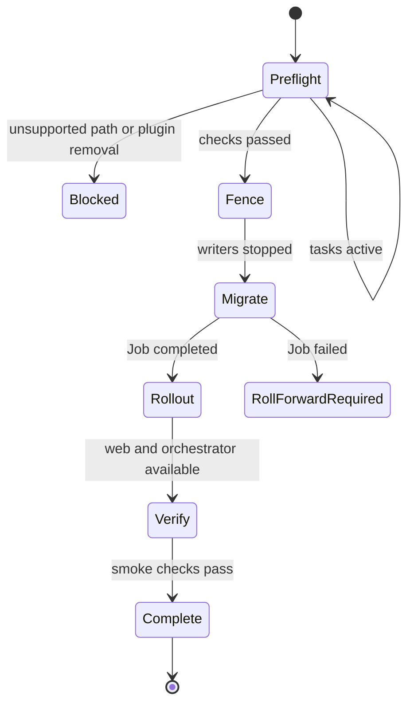

# Upgrades

!!! note "Status"
    Preflight, Fence, Migrate, Verify, and the roll forward guard are implemented in the `Foreman` controller. The upgrade E2E test installs the released `0.1.0` chart and upgrades it to the current images. The `Release` CRD for compatible image sets is target design.

Until `Release` exists, an upgrade is a new image in `Foreman.spec.image`, or a new operator version whose default image tag changed. A change of `spec.plugins` runs the same flow.

## Preflight

The operator computes a hash over the image reference and the sorted plugin list. When it differs from `status.appliedMigrationHash`, a preflight runs while the previous version keeps serving:

1. The Job `<name>-preflight-<hash>` starts the new image and reads `/usr/share/foreman/VERSION`.
2. On a fresh install, the checks below are skipped.
3. Disabling `foreman-tasks`, `foreman_remote_execution`, or `foreman_ansible` is refused with phase `Blocked`. These plugins schedule Dynflow tasks that reference their code, and `foreman-tasks` always schedules recurring tasks, so the Dynflow orchestrator would crash on the next start.
4. The version path from `status.foremanVersion` to the new version must be one release at a time: a rebuild or patch release, the next minor release, or the first minor release of a later major version, for example `3.19` to `5.0`. Skipped releases and downgrades are refused with phase `Blocked`. For installations from an operator version that did not record `status.foremanVersion`, the running Foreman is asked through `/api/v2/status`.
5. With `foreman-tasks` enabled, the operator waits until no task is `planning`, `running`, or `paused`. Resume or cancel paused tasks. Scheduled tasks, such as recurring cleanups, survive the upgrade.

A blocked preflight is checked again every minute. A task can still start between the check and the stop of the writers.

## Fence and migrate

1. The recurring task CronJobs are suspended, and all web and Dynflow Deployments are scaled to zero. The frontend runs in the web pods, so Foreman is unreachable until the rollout.
2. The controller waits until no Foreman pods remain, including running recurring tasks. Finished pods and the preflight and migration pods do not count.
3. Older migration Jobs are deleted, and the Job `<name>-migrate-<hash>` runs `db:migrate`, `db:seed`, and `upgrade:run`. `upgrade:run` executes one-time data tasks of a release and refuses to run while migrations or seeds are pending.
4. After the Job completes, the hash, the version, and the plugin list are recorded and the Deployments roll out with the new image.

## Roll forward

There is no automatic rollback: once the migration Job exists, the database may be partly migrated for the new version.

- A failed Job sets the phase `RollForwardRequired`. Read the Job logs. Delete the Job to retry with the same image, or set a fixed image to roll forward. The preflight of the fixed image checks only the version path, since Foreman is stopped.
- Setting the previous image again after the migration Job started is refused with phase `RollForwardRequired`, and Foreman stays stopped. Going back is only safe after restoring the database from a backup taken before the upgrade.
- Going back before the migration Job started, for example while the writers stop, is allowed.

## Verify

After the rollout, the `Ready` condition becomes `True`, so the Smart Proxies refresh their features. The condition `Verified` stays `False` until:

- `/api/v2/status` answers with the version in `status.foremanVersion`, and
- every `SmartProxy` of this Foreman is ready and refreshed its features since the migration (`status.foremanMigrationHash`).

Then `status.verifiedMigrationHash` is set and `Verified` becomes `True` with reason `SmokeChecksPassed`.

## Overriding the checks

The annotation `platform.theforeman.org/skip-upgrade-checks: "true"` skips the preflight checks and the roll forward guard. Use it only to recover, for example when the running Foreman is broken and cannot answer the preflight, or after restoring the database. Remove it afterwards.

Smart Proxies are upgraded after Foreman. DHCP and TFTP keep serving during a Foreman upgrade, but Foreman cannot change reservations while it is fenced.

## Health

Web startup, readiness, and liveness probes use the HTTP status of `/api/v2/ping` only, with the `Host` header set to `spec.fqdn`. The response body includes dependency status, which must not remove all web pods when a dependency fails.

The Smart Proxy probes complete a TLS handshake with `curl` against `/version` and accept any HTTP status. A plain TCP check would make WEBrick log an SSL error on every probe.

## Backup and restore

Losing any of these makes a restore partly or fully unusable:

- the Secret `<name>-secrets`, which holds the Foreman `ENCRYPTION_KEY`, `SECRET_KEY_BASE`, and the OAuth consumer
- the internal CA key
- The Remote Execution SSH key Secrets of `Execution` proxies
- the TFTP root on the proxy volume

A `Backup` kind is deferred until manual procedures have been tested.
