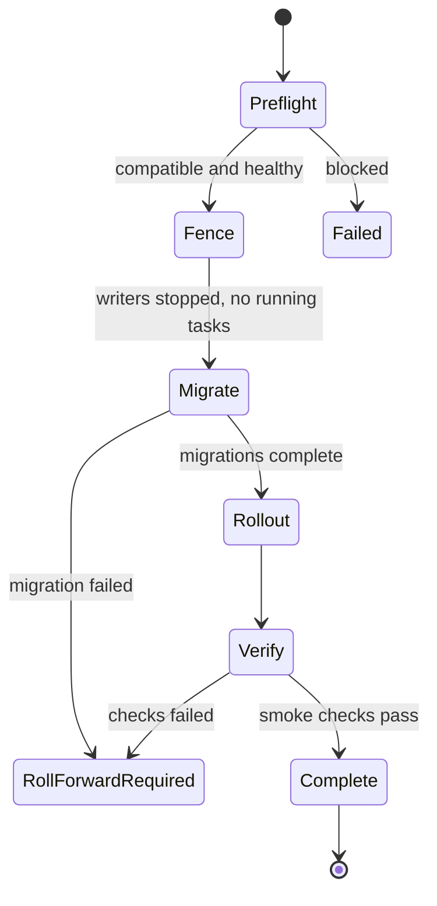

# Upgrades

!!! note "Status"
    Target design. The `Release` CRD does not exist yet.

Until `Release` exists, an upgrade is a new image in `Foreman.spec.image`, with the migration Job running before the rollout. This is intended for testing only.

- **Preflight** checks image compatibility, single-step upgrade, certificate validity, and running tasks. Foreman must be upgraded one release at a time.
- **Fence** stops every writer to a schema being migrated.
- **Migrate** runs one Job per schema owner.
- Automatic rollback is not offered after a migration has run.
- Smart Proxies are upgraded after Foreman. DHCP and TFTP keep serving during a Foreman upgrade, but Foreman cannot change reservations while it is fenced.

## Health

Web readiness uses the HTTP status of `/api/v2/ping` only. The response body includes dependency status, which must not remove all web pods when a dependency fails.

## Backup and restore

Losing any of these makes a restore partly or fully unusable:

- Foreman `ENCRYPTION_KEY`
- the internal CA key
- Smart Proxy OAuth credentials and SSH keys
- DHCP data on the proxy volume

A `Backup` kind is deferred until manual procedures have been tested.
